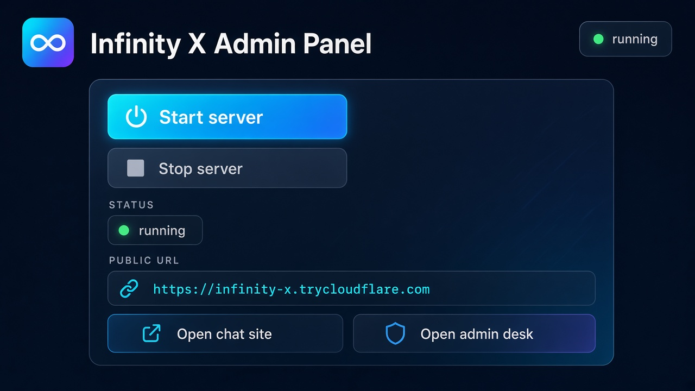
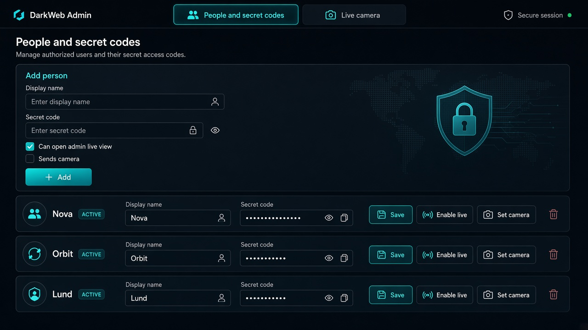

# Infinity X

Private chat with secret codes, a **separate admin desk**, and a **desktop admin panel** that starts the server and prints a public link.





## Cosa riceve l’admin panel

L’app desktop (`Start Admin Panel.bat`) è il pannello di controllo, separato dalla chat.

| Pulsante | Cosa fa |
| --- | --- |
| **Start server** | Avvia API, sito web e tunnel Cloudflare |
| **Stop** | Ferma quei processi |
| **Open chat site** | Apre il sito pubblico per gli utenti |
| **Open admin desk** | Apre il pannello admin (`/desk`), fuori dalla chat |

Dal desk, con il codice **`xadmin`**, l’admin può:

- vedere e cambiare **nomi** e **codici segreti**
- **aggiungere** una persona (nome + codice)
- **eliminare** una persona (tranne Nova e Orbit, che restano)
- decidere chi **vede la live** e chi **manda la camera**
- aprire **Live camera** (fronte / retro) quando il codice streamer è online

Gli altri utenti ricevono solo la chat, con il codice che l’admin ha creato.

## Avvio rapido

1. `npm install`
2. Copia `.env.example` in `.env` e imposta `DATABASE_URL`, `REDIS_URL`, `SESSION_SECRET`
3. Doppio clic su **`Start Admin Panel.bat`**
4. Premi **Start server**
5. Copia il link `https://….trycloudflare.com`
6. Apri **Open admin desk** e entra con `xadmin`

Codice admin di default: `xadmin`. Codice camera di default: `IX-NOVA-7X`.

Il link pubblico esiste solo finché il PC e il tunnel restano accesi.

---

# Infinity X Messenger

Piattaforma di messaggistica self-hosted (concetto simile a WhatsApp/Telegram), **senza Firebase**. Backend Node.js, PostgreSQL, Redis, WebSocket autenticato, predisposizione Cloudflare Tunnel ed E2EE.

HTTPS/TLS **non** è End-to-End Encryption. Vedi `docs/e2ee.md`.

## 1. Requisiti

- Node.js 20.11+
- npm 10+
- Docker e Docker Compose (per Postgres, Redis, produzione)
- Opzionale: account Cloudflare e `cloudflared` per il tunnel

## 2. Installazione

```bash
git clone <repo>
cd xxx
cp .env.example .env
```

Genera `SESSION_SECRET` (almeno 32 caratteri casuali) e una password PostgreSQL robusta. Non committare `.env`.

```bash
npm install
```

## 3. Configurazione `.env`

Copia `.env.example` → `.env`. Variabili principali:

| Variabile | Scopo |
| --- | --- |
| `DATABASE_URL` | PostgreSQL |
| `REDIS_URL` | Redis |
| `SESSION_SECRET` | HMAC sessioni / IP hash (non per password) |
| `APP_URL` / `CORS_ORIGIN` | Origine del frontend |
| `CLOUDFLARE_TUNNEL_TOKEN` | Token tunnel (mai nel git) |
| `SMTP_*` | Email verifica/reset (in dev i link vanno nei log) |
| `BOOTSTRAP_ADMIN_EMAIL` | Se impostata, promuove a `admin` **solo** quell’email al register |

Non esiste un account admin hardcoded.

### Codici di accesso (Infinity X)

Accesso solo con codice segreto — niente registrazione. Ogni codice corrisponde a un profilo:

| Profilo | Codice (default dev) | Ruolo |
| --- | --- | --- |
| Nova | `IX-NOVA-7X` | Streamer (live cam) |
| Orbit | `IX-ORBIT-7X` | Admin |
| Vega | `IX-VEGA-9K` | Chat |
| Lyra | `IX-LYRA-4M` | Chat |
| Atlas | `IX-ATLAS-8R` | Chat |
| Ember | `IX-EMBER-2Q` | Chat |

Personalizza i codici in `.env` (`ACCESS_CODE_*`). Al primo login vengono creati gli utenti, chat dirette tra tutti e il gruppo **Infinity X** per chattare insieme.

## 4. Avvio sviluppo

Avvia Postgres e Redis (Docker) **oppure** istanze locali.

```bash
docker compose up -d postgres redis
npm run db:generate
npm run db:migrate
npm run dev:server
npm run dev:web
```

Frontend: `http://localhost:5173` (proxy Vite verso API/WS su `:3000`).

## 5. Avvio Docker

```bash
cp .env.example .env
# modifica secret, password DB, APP_URL, CORS_ORIGIN (es. http://localhost:8080)
docker compose up --build
```

UI: `http://localhost:8080`. PostgreSQL e Redis **non** sono pubblicati sull’host.

Tunnel Cloudflare:

```bash
docker compose --profile tunnel up --build
```

Richiede `CLOUDFLARE_TUNNEL_TOKEN`.

## 6. Database migration

```bash
npm run db:migrate          # sviluppo
# in container backend: prisma migrate deploy
```

Schema: `prisma/schema.prisma`.

## 7. Seed database

```bash
SEED_USER_PASSWORD='CorrectHorse-99!' npm run db:seed
```

Crea `alice@example.com` e `bob@example.com` con ruolo **user**. Nessun admin.

## 8. Test

```bash
npm test
```

I test di integrazione auth/IDOR richiedono `DATABASE_URL`, `REDIS_URL`, `SESSION_SECRET`, `APP_URL`, `CORS_ORIGIN`.

## 9. Build produzione

```bash
npm run build
docker compose up --build -d
```

In produzione: `NODE_ENV=production`, cookie `Secure`, `TRUST_PROXY=true`, CORS esplicito (mai `*`), HTTPS tramite Cloudflare.

## 10. Configurazione Cloudflare

1. Crea un dominio sul dashboard Cloudflare.
2. SSL/TLS: **Full (strict)** quando l’origine è raggiungibile in HTTPS; con tunnel verso HTTP interno usa **Full** e termina TLS a Cloudflare.
3. Abilita HTTPS automatico e HSTS sul dominio.

Dettagli: `docs/cloudflare.md`.

## 11. Configurazione `cloudflared`

1. Zero Trust → Networks → Tunnels → Create.
2. Copia il **token** in `CLOUDFLARE_TUNNEL_TOKEN` (secret manager / `.env` locale).
3. Public hostname → servizio `http://frontend:80` (nginx fa da reverse proxy verso API/WS).
4. Non esporre porte origin su Internet. Il tunnel entra nella rete Docker interna.

Esempio locale: `infra/cloudflare/config.yml`.

## 12. DNS

Crea un record CNAME (o l’hostname del tunnel) verso `*.cfargotunnel.com` come indicato da Cloudflare. Non aprire `5432`/`6379` sul firewall.

## 13. HTTPS

Cloudflare termina TLS verso i client. L’origin dietro tunnel non deve essere HTTP pubblico. Imposta cookie `Secure` con `NODE_ENV=production`.

## 14. Backup PostgreSQL

Il tunnel **non** sostituisce i backup.

```bash
# Git Bash / WSL
export POSTGRES_USER=ixm POSTGRES_DB=infinity_x BACKUP_RETENTION_DAYS=14
bash scripts/backup.sh
bash scripts/restore.sh backups/ixm-....sql.gz
```

Vedi `docs/backup.md`.

## 15. Aggiornamenti

1. Backup DB.
2. `git pull`
3. `docker compose build --no-cache backend frontend`
4. `docker compose up -d`
5. Le migrate partono all’avvio del backend (`prisma migrate deploy`).

## 16. Security checklist

- [ ] Nessun secret nel repository
- [ ] `SESSION_SECRET` e password DB unici e lunghi
- [ ] Redis e Postgres solo sulla rete Docker interna
- [ ] CORS ristretto all’origine reale
- [ ] SMTP configurato in produzione per verifica/reset
- [ ] Rate limit Redis attivo
- [ ] Backup automatici e restore provato
- [ ] Tunnel token ruotabile
- [ ] Nessun admin di default
- [ ] Upload su volume dedicato, download con `Content-Disposition: attachment`
- [ ] Review `docs/security.md`

API versionata: `docs/api.md`.
